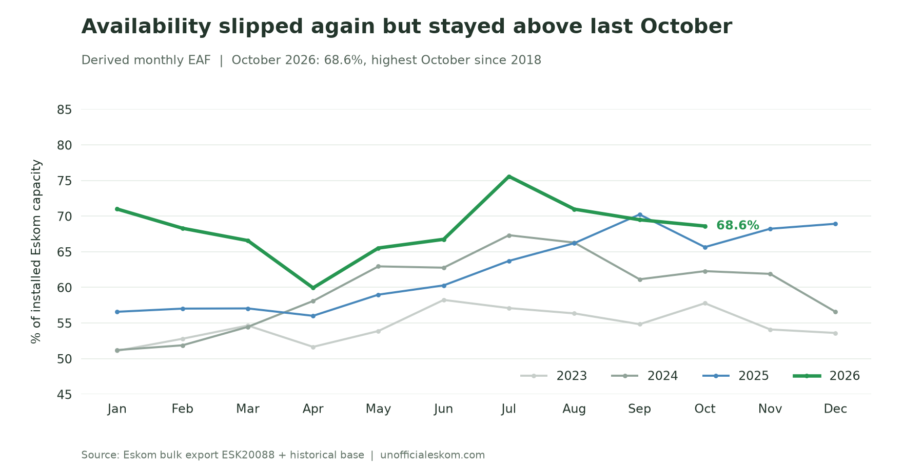
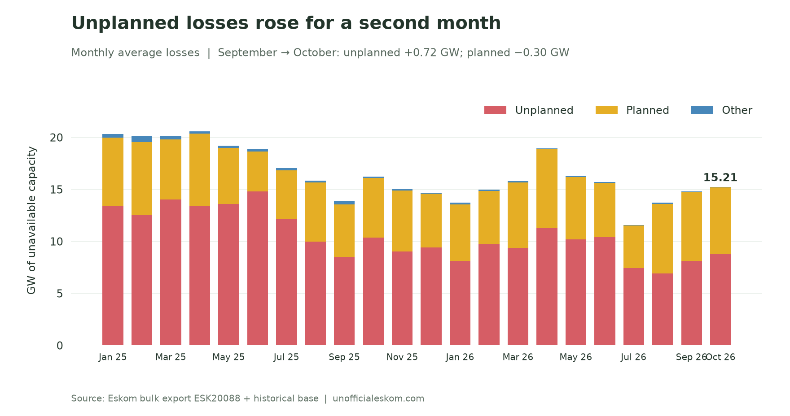
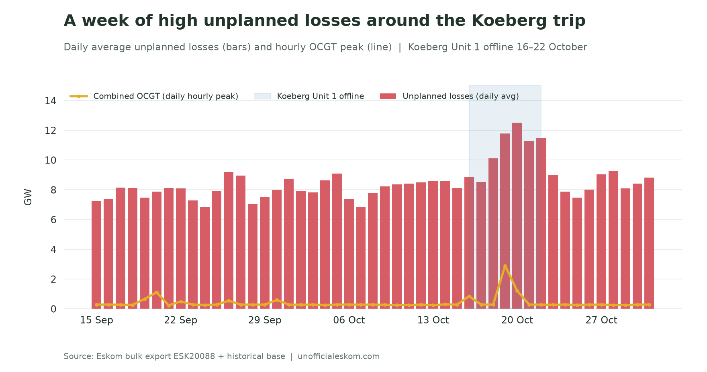
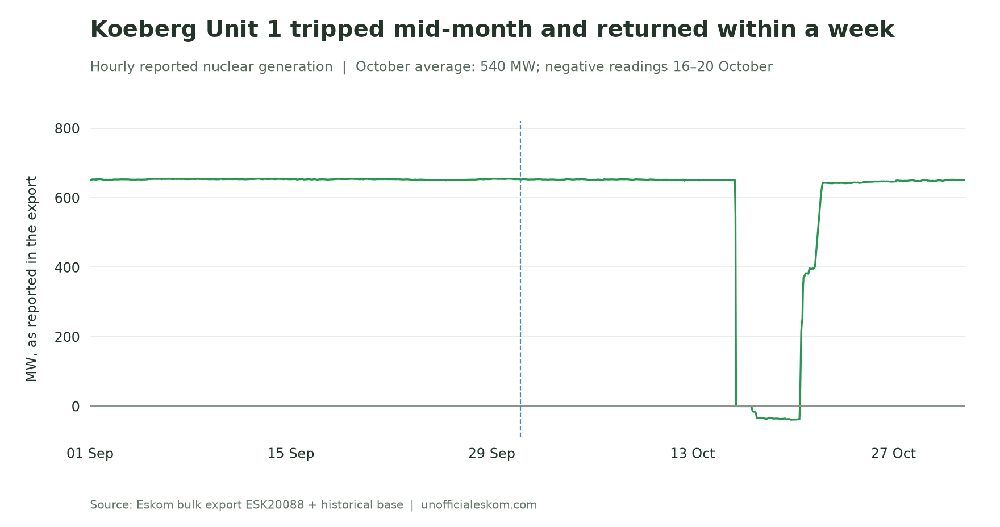
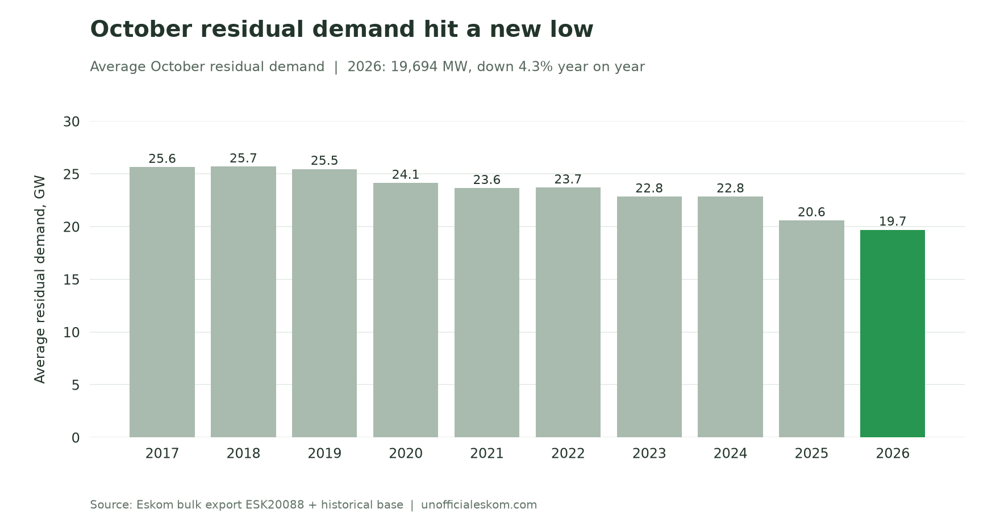
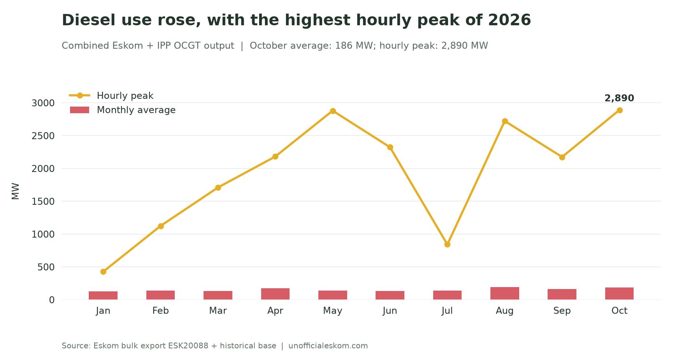
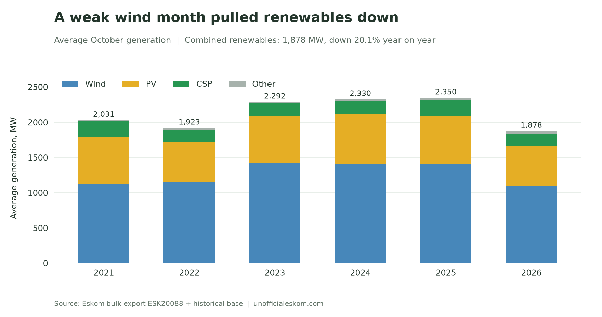

Eskom's derived Energy Availability Factor slipped for a third month in October, to **68.6%**. Most of the month looked like September. The exception was the week of 16–22 October, when Koeberg Unit 1 tripped and unplanned losses climbed above 12 GW for a day.

That week also brought the highest hourly diesel use of 2026. Residual demand kept falling and set a new October low, while weak wind pulled renewable output well below last year.

October 2026 saw:

- **EAF fall 0.9 percentage points** from September, but rise 2.9 points from October 2025
- **Unplanned losses rise by 0.72 GW**, to 8.82 GW
- **Nuclear generation average 540 MW**, down 17.3% from September after the Koeberg Unit 1 trip
- **Residual demand average 19,694 MW**, the lowest October in the bulk record
- **Combined OCGT output peak at 2,890 MW**, the highest hour since July 2025
- **Wind generation fall 22.5% year on year**, its weakest October since 2020, while PV set an all-time hourly high

{/* truncate */}

## One bad week pulled availability lower

October's **68.6% derived EAF** was below September's 69.5%, but above October 2025's 65.7%. It was the highest October figure since 2018 (69.4%).

*Availability fell for a third month, but remained above every October since 2018.*

Unplanned losses increased from **8.10 GW in September to 8.82 GW in October**. Planned losses eased from 6.65 GW to 6.35 GW, and other losses were almost unchanged at 33 MW. Total losses rose from **14.78 GW to 15.21 GW**. Installed Eskom capacity stayed at 48,436 MW, so this month's EAF change comes from losses alone.

*Lower planned maintenance only partly offset higher unplanned losses.*

Year on year, unplanned losses were **1.53 GW lower** than in October 2025, while planned losses were 0.62 GW higher.

The monthly average hides a sharp spike. Unplanned losses ran at 8.1–8.9 GW a day for the first half of October. They then rose to 10.1 GW on 18 October, 11.8 GW on 19 October and **12.5 GW on 20 October**, before returning below 9 GW from 23 October. The derived EAF for 20 October was **60.0%**, against 71.9% on the month's best day.

*Unplanned losses rose by about 4 GW for five days, and diesel use spiked with them.*

The Koeberg trip explains only part of that rise: the unit was producing about 650 MW before it tripped. The bulk export does not show which other units were unavailable during the same week.

## Koeberg Unit 1 tripped and returned within a week

Nuclear generation held at about **650 MW for the first 15 days** of October, the same level as September. Output fell to zero on 16 October and stayed at small negative values (the station's own consumption, about −35 MW) from 17 to 20 October. It returned on 20 October and was back above 640 MW from 22 October.

*The export shows an outage of about five days, followed by a return to the earlier output level.*

Eskom said Unit 1 was [taken offline on 16 October](https://www.greenbuildingafrica.co.za/koeberg-unit-1-trips-during-testing-taken-offline/) after an electrical protection system operated in response to a disturbance during testing for Unit 2's planned outage. It [confirmed on 22 October](https://www.greenbuildingafrica.co.za/eskom-returns-koeberg-unit-1-to-service-after-protection-system-trip/) that the unit was synchronised to the grid again. Unit 2 remains on planned maintenance. This was a separate event from August's [turbine trip linked to sardines at the seawater intake](https://www.news24.com/business/climate-future/energy/sardine-plagued-koeberg-unit-taken-offline-after-trip-20260827-0998).

October nuclear output averaged **540 MW**, down 17.3% from September and **42.5% below October 2025's 938 MW**.

## Demand set another October low

Average residual demand was **19,694 MW**, down 1.5% from September and 4.3% from October 2025. This is the lowest October in the record, which begins in April 2017, and the fourth-lowest month overall. October 2017 averaged 25,647 MW: the decline since then is 23.2%.

*Average October residual demand is 23% lower than in 2017.*

The month's demand peak was **25,521 MW at 19:00 on 1 October**. During the high-outage week, daily peaks stayed between 22 GW and 25 GW, including 24,967 MW on 19 October.

## Diesel peaked during the outage week

Combined Eskom and IPP open-cycle gas turbine generation averaged **186 MW**, up 13.4% from September and 47.8% from October 2025. October's combined OCGT energy total was **138.3 GWh**.

*October's average rose modestly, but its hourly peak was the highest of the year.*

The peak reached **2,890 MW at 19:00 on 19 October**, the highest hour in the export since July 2025. All five hours above 1 GW came during the outage week: 18:00–20:00 on 19 October, and 06:00 and 19:00 on 20 October. Outside those two days, the daily peak stayed below 300 MW, except for 848 MW on 16 October, the day of the Koeberg trip.

Both ILS usage and the export's manual load reduction field were zero throughout October. These fields do not measure every form of local electricity interruption.

## Weak wind pulled renewables down

Wind generation averaged **1,096 MW**, down 22.5% year on year and 26.5% from September. It was the weakest October for wind since 2020. PV averaged **572 MW**, down 14.4% year on year, and CSP averaged **168 MW**, down 26.8%.

*Lower wind, PV and CSP output all reduced the October total.*

Combined wind, PV, CSP and other renewable output averaged **1,878 MW**, down 20.1% from October 2025 and 9.5% from September. It was the lowest October total since 2020.

Despite the lower monthly average, PV set an **all-time hourly high of 2,546 MW at 11:00 on 23 October**, above the previous record of 2,475 MW. Wind's hourly maximum was 2,903 MW, below October 2025's 3,017 MW.

Thermal generation averaged 17,807 MW, down 7.1% year on year. Electricity trade remained a small net import position: imports averaged **896 MW** and exports 764 MW, leaving net imports of 131 MW. October 2025 had instead averaged net exports of 1,387 MW.

October's decline came from one week rather than a broad deterioration. Outside 18–22 October, unplanned losses stayed close to September's level, and demand remained low enough to keep diesel use modest.

---

*Method: hourly data from Eskom bulk export `ESK20088.csv`, merged with the historical base covering April 2017 onward. All 744 October hours have values for the metrics discussed. EAF is calculated hourly as 100 × (1 − (PCLF + UCLF + OCLF) / installed Eskom capacity), then averaged; it is not Eskom's separately published official monthly EAF. All comparisons use this latest merged export. Eskom revised some September figures: combined renewables from 2,081 MW to 2,075 MW, and unplanned losses and non-commercial sent-out in August and September by small amounts; comparisons here use the revised values. Times follow the source hour labels. “October records” mean October observations in this dataset, and renewable figures cover the export's wind, PV, CSP and other RE series, without adding a separate rooftop-PV estimate. Charts and analysis by [unofficialeskom.com](https://unofficialeskom.com).*
